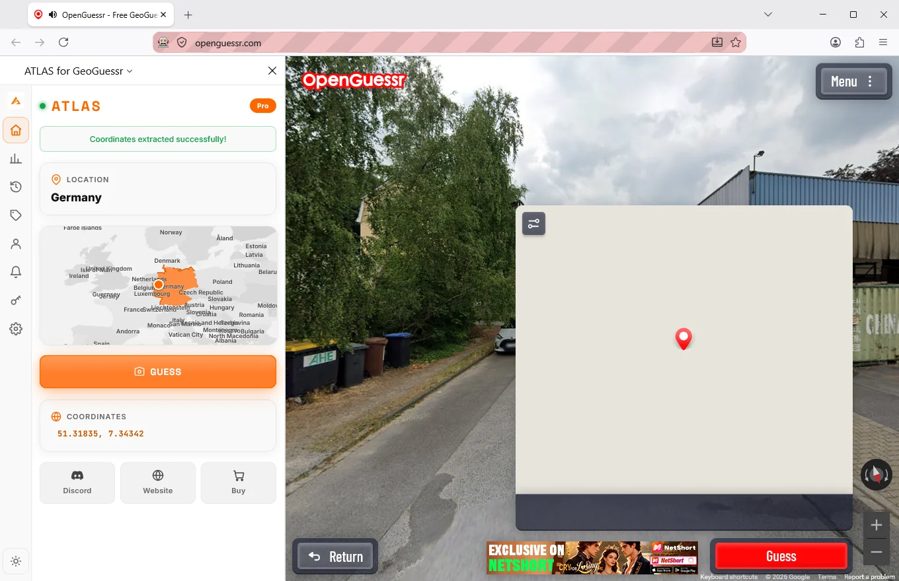
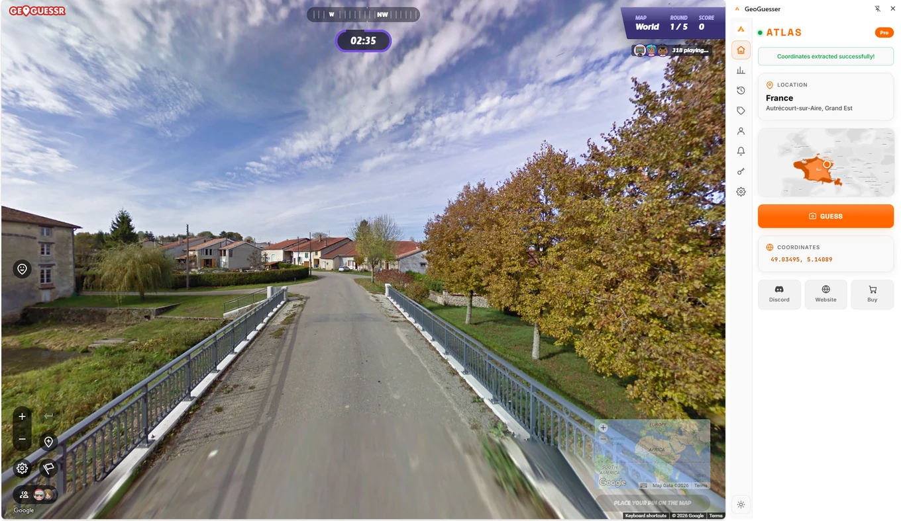

# GeoGuessr Cheat for Mac: ATLAS on macOS

  

  <b>A GeoGuessr cheat that runs on a MacBook, through the browser, on the same licence key as Windows.</b> 
  Country, region and coordinates in the panel, and the pin placed for you. No Mac app to install.

  
  
  
  
  
  
  

  <a href="https://github.com/Sven233333/Atlas-geoguessr-bot"><b>All platforms</b></a> &middot;
  <a href="https://github.com/Sven233333/atlas-geoguessr-chrome-extension">Chrome</a> &middot;
  <a href="https://github.com/Sven233333/atlas-geoguessr-firefox-addon">Firefox</a> &middot;
  <a href="https://geoguessrcheats.com/faq">FAQ</a>

Short answer first, because most pages make you read three paragraphs before they
admit what is missing.

| On a Mac | |
|---|---|
| Read the round and name the country | Yes |
| Show the region, town and coordinates | Yes |
| Drop the pin on the map for you | Yes |
| Seven free rounds before you buy | Yes |
| Press the guess button for you | In Chrome yes, in Firefox not yet |
| Play whole sessions on its own | No |
| Drive the Steam edition | No |
| Cost extra on top of a key you own | No |

Everything in the yes column arrives through the browser extension. There is no
Mac application to install.

---

## What you actually install

An extension, in the browser you already use. Both are supported and both use the
same licence key:

- **Chrome on macOS**, plus Edge, Brave, Opera and Vivaldi.
  [Details and store link](https://github.com/Sven233333/atlas-geoguessr-chrome-extension)
- **Firefox 128 or newer on macOS**.
  [Details and store link](https://github.com/Sven233333/atlas-geoguessr-firefox-addon)

Support for Macs landed with v1.6. Before that release it was a Windows only
product, and the honest reason it took until then is that the browser side had to
be good enough to stand on its own first.

## Why there is no Mac app

The desktop application is the version that starts matches and plays session after
session while you are not there. It exists for Windows and only for Windows.

Two separate reasons, and neither of them is going to change quietly:

1. The unattended part is deeply tied to how it drives a Windows desktop.
2. GeoGuessr on Steam, which the desktop app can also play, has no Mac client to
   drive in the first place.

So if the thing you want is a bot that grinds overnight, a Mac is the wrong
machine and we would rather say so than sell you a key that disappoints you. That
version lives here:
[atlas-geoguessr-windows-app](https://github.com/Sven233333/atlas-geoguessr-windows-app).

## Setting it up

1. Pick a browser, Chrome or Firefox.
2. Install the ATLAS extension from that browser's store.
3. Open a round. The panel opens beside it.
4. Play seven free rounds. If you want more, a key is
   [14.99 euro per month, 33.50 per year, or 50 once](https://geoguessrcheats.com/plans),
   and nothing renews by itself.

## Apple Silicon and Intel

Both. The extension is browser software, so whatever your Mac runs, it runs.
Nothing is compiled for your machine and nothing about the prediction happens on
it either.

## Questions

**Is there a Safari version?**
No. Chrome and Firefox are the supported browsers on macOS.

**Can I run the Windows app under Parallels or Crossover?**
Unsupported. It may start, but nothing about that path is tested and nothing about
it is promised.

**If I buy a key on my Mac, does it work on a Windows PC later?**
Yes. The key is not bound to an operating system, and iPhone and Android are
included too.

**Does an iPad count as a Mac here?**
No, that is a separate app with its own install route:
[atlas-geoguessr-ios](https://github.com/Sven233333/atlas-geoguessr-ios).

**Where is the full comparison?**
[geoguessrcheats.com/platforms](https://geoguessrcheats.com/platforms), and the
overview repository is
[Atlas-geoguessr-bot](https://github.com/Sven233333/Atlas-geoguessr-bot).

## Disclaimer

Independent project. No connection to GeoGuessr AB or to Apple. Whether you are
allowed to use an assistant depends on the rules of the game or competition, which
are yours to read.
